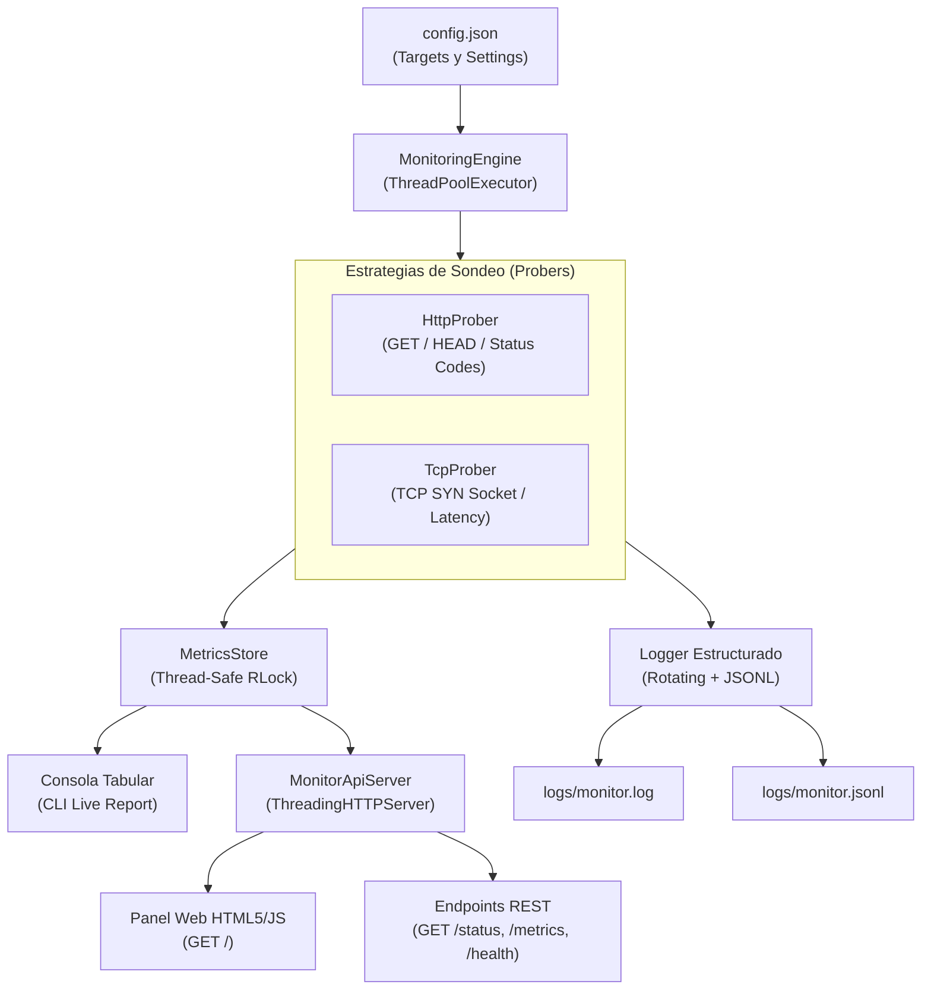

# 🚀 API y Motor de Monitoreo de Estado de Servidores

> **Proyecto de Portafolio:** Aplicación resiliente y concurrente para verificación periódica de disponibilidad de servicios web (HTTP/HTTPS) y direcciones IP / puertos de red (TCP), con registro estructurado rotativo en JSON Lines, cálculo de SLAs y panel web en tiempo real.

---

## 🎯 Resumen Ejecutivo y Alcance

Esta aplicación verifica de forma periódica y concurrente la salud operativa de una lista de endpoints y servidores configurables, detectando caídas, latencias anómalas y degradaciones de servicio.

### Alcance Cumplido
- ✅ **Lista de Targets Configurable:** Archivo `config.json` con soporte para métodos HTTP, códigos esperados, intervalos y timeouts independientes por objetivo.
- ✅ **Sondeo Concurrente Periódico:** Rutina multi-hilo basada en `ThreadPoolExecutor` con temporizadores independientes y apagado limpio (*Graceful Shutdown*).
- ✅ **Medición de Latencia de Alta Precisión:** Registro en milisegundos del tiempo de respuesta y cálculo de medias móviles.
- ✅ **Reporte Dual:** Salida visual formateada por consola y **Servidor de API REST + Dashboard Web interactivo** en tiempo real.
- ✅ **Registro Estructurado Profesional:** Handler rotativo para humanos (`logs/monitor.log`) y formato JSON Lines (`logs/monitor.jsonl`) para agregadores tipo Datadog, ElasticSearch o Grafana Loki.
- ✅ **Cero Dependencias Externas:** 100% construido sobre la **Biblioteca Estándar de Python** (funciona al instante con `python main.py` en cualquier entorno).

---

## 🧠 Puntos Clave para la Entrevista Técnica

Este proyecto está diseñado para defender las siguientes competencias de ingeniería de software:

| Tema Clave | Implementación en el Código | Justificación Técnica |
| :--- | :--- | :--- |
| **Manejo de Red y Sockets** | [`monitor/probers.py`](monitor/probers.py) | Implementa `HttpProber` (capa de aplicación) y `TcpProber` (capa de transporte). Mide la negociación del handshake SYN/ACK de sockets sin requerir permisos root de ICMP. |
| **Control Granular de Excepciones** | [`monitor/probers.py`](monitor/probers.py) | No usa bloques `except Exception` genéricos para enmascarar fallos; discrimina `socket.gaierror` (DNS), `socket.timeout` (Timeout), `ConnectionRefusedError` (Servicio apagado/Firewall) y `HTTPError` (Códigos 4xx/5xx). |
| **Concurrencia y Sincronización** | [`monitor/engine.py`](monitor/engine.py) y [`monitor/store.py`](monitor/store.py) | Utiliza `ThreadPoolExecutor` para evitar bloqueos por latencia de red. Protege estados compartidos con `threading.RLock` frente a escrituras de workers y lecturas de la API HTTP. |
| **Estructuración Limpia de Datos** | [`monitor/models.py`](monitor/models.py) | Uso intensivo de `@dataclass` con tipos fuertes (`TargetConfig`, `CheckResult`, `TargetMetrics`), validaciones en `__post_init__` y cálculo incremental de SLA de disponibilidad (`Uptime %`). |
| **Resiliencia y Graceful Shutdown** | [`monitor/engine.py`](monitor/engine.py) y [`main.py`](main.py) | Captura señales `SIGINT` (Ctrl+C) y `SIGTERM`, detiene hilos de forma ordenada cancelando tareas pendientes y liberando descriptores de socket. |

---

## 🏗️ Arquitectura del Sistema



---

## 📂 Estructura del Proyecto

```text
API de Monitoreo de Estado de Servidores/
├── config.json                     # Archivo de configuración de servicios y parámetros
├── main.py                         # Punto de entrada unificado (CLI, Runner y Servidor)
├── requirements.txt                # Libre de dependencias externas (100% Python StdLib)
├── .gitignore                      # Exclusiones estándar de Python y logs
├── monitor/                        # Paquete modular de la aplicación
│   ├── __init__.py
│   ├── config.py                   # Carga y validación robusta de esquemas JSON
│   ├── models.py                   # Modelos fuertemente tipados (Dataclasses y Enums)
│   ├── probers.py                  # Sondeadores de red (HTTP y TCP con control de fallos)
│   ├── engine.py                   # Orquestador concurrente y bucle de eventos
│   ├── store.py                    # Repositorio thread-safe de métricas y SLAs
│   ├── logger.py                   # Logging rotativo humano + JSON Lines
│   └── api.py                      # Servidor HTTP REST y Dashboard Web en tiempo real
├── tests/                          # Suite completa de pruebas automatizadas
│   ├── __init__.py
│   ├── test_config.py              # Validación de campos y esquemas
│   ├── test_probers.py             # Mocks de red (DNS, Timeout, Refused, 500)
│   ├── test_store.py               # Cálculos matemáticos de disponibilidad y latencia
│   └── test_api.py                 # Pruebas funcionales de endpoints HTTP
└── logs/                           # Directorio autogenerado con registros de eventos
    ├── monitor.log                 # Registro rotativo de texto
    └── monitor.jsonl               # Registro de telemetría estructurada
```

---

## ⚡ Guía de Inicio Rápido

### 1. Requisitos
- **Python 3.10 o superior** (probado y verificado en Python 3.14).
- No requiere ejecutar `pip install` para funcionar.

### 2. Ejecución Estándar (Modo Completo)
Inicia el motor concurrente, los logs periódicos, el reporte por consola y el panel web:
```bash
python main.py
```

### 3. Acceso al Panel Web y API
Abre tu navegador en:
- **Panel Web en Tiempo Real:** [http://127.0.0.1:8080/](http://127.0.0.1:8080/)
- **Estado de Servicios (JSON):** [http://127.0.0.1:8080/status](http://127.0.0.1:8080/status)
- **Health Check del Monitor:** [http://127.0.0.1:8080/health](http://127.0.0.1:8080/health)
- **Métricas Agregadas:** [http://127.0.0.1:8080/metrics](http://127.0.0.1:8080/metrics)
- **Objetivos Registrados:** [http://127.0.0.1:8080/targets](http://127.0.0.1:8080/targets)

---

## 🛠️ Modos de Ejecución Avanzados (CLI Flags)

| Comando | Descripción |
| :--- | :--- |
| `python main.py --once` | Realiza una **única ronda de sondeo inmediata**, imprime la tabla de resultados y termina (ideal para cron jobs o pipelines de CI/CD). |
| `python main.py --no-api` | Ejecuta el monitoreo periódico únicamente por consola y logs, sin levantar el puerto HTTP. |
| `python main.py -p 9090` | Sobrescribe el puerto de la API REST (por ejemplo, a `9090`). |
| `python main.py -c mi_config.json` | Carga un archivo de configuración alternativo. |

---

## 🧪 Pruebas Automatizadas (Testing)

El proyecto incluye 18 pruebas unitarias y de integración que validan los componentes aislados mediante mocks:

```bash
python -m unittest discover -s tests -v
```

**Cobertura de pruebas:**
- Validación de URLs, tipos de targets y rangos de puertos.
- Simulación de fallos DNS (`socket.gaierror`).
- Simulación de timeouts de conexión HTTP y TCP.
- Simulación de conexiones rechazadas (`ConnectionRefusedError`).
- Respuestas HTTP con errores de servidor (500) y cliente (404).
- Cálculo exacto de disponibilidad porcentual (`uptime_percentage`).
- Integración real con el servidor de endpoints REST HTTP.

---

## 📡 Ejemplo de Respuesta JSON (`GET /status`)

```json
{
  "system": {
    "monitor_uptime_seconds": 12.4,
    "total_monitored_services": 6,
    "services_up": 4,
    "services_down": 1,
    "services_degraded": 1,
    "global_uptime_percentage": 66.67,
    "healthy": false
  },
  "services": [
    {
      "target_id": "google_public_dns",
      "target_name": "Google Public DNS",
      "target_type": "tcp",
      "target_endpoint": "8.8.8.8:53",
      "current_state": "UP",
      "total_checks": 1,
      "successful_checks": 1,
      "failed_checks": 0,
      "uptime_percentage": 100.0,
      "last_response_time_ms": 152.0,
      "min_response_time_ms": 152.0,
      "max_response_time_ms": 152.0,
      "avg_response_time_ms": 152.0,
      "last_check_iso": "2026-10-25T20:38:02.120000+00:00",
      "last_error": null,
      "consecutive_failures": 0
    }
  ]
}
```

---

## 📝 Formato de Registro de Logs

### 1. Archivo Rotativo para Humanos (`logs/monitor.log`)
```text
[2026-10-25 15:38:02] [INFO] [ProberWorker_0] [UP] Google Public DNS (TCP) - Latencia: 152.0ms | Código: 0
[2026-10-25 15:38:02] [ERROR] [ProberWorker_1] [DOWN] Simulated DNS Error (HTTP) - Latencia: 89.6ms | Error: Fallo DNS: No se pudo resolver el nombre de host
```

### 2. Archivo Estructurado para APMs (`logs/monitor.jsonl`)
```json
{"timestamp": "2026-10-25 15:38:02,120", "level": "INFO", "logger": "ServerMonitor", "message": "[UP] Google Public DNS (TCP) - Latencia: 152.0ms", "check": {"target_id": "google_public_dns", "target_name": "Google Public DNS", "target_type": "tcp", "state": "UP", "is_up": true, "response_time_ms": 152.0, "status_code": 0, "error_message": null}}
```

---

## 👤 Autor y Licencia
Desarrollado como proyecto de demostración de ingeniería de software para portafolio técnico y entrevistas. Código abierto bajo licencia MIT.
